# SkillWeaver-NIS

Neural Interaction Skills (NIS) for [SkillWeaver](https://github.com/Ada4321/SkillWeaver): the closed-loop
PPO policies that the SkillWeaver agent invokes for contact-rich manipulation (Pick, Place, Open, Close),
with their Isaac Lab training environments and the checkpoints used in the paper.
The checkpoints and example assets are on [Hugging Face](https://huggingface.co/datasets/Ada-4321/SkillWeaver-NIS).

[**Project Page**](https://katefgroup.github.io/skillweaver/) &nbsp;|&nbsp;
[**arXiv**](https://arxiv.org/abs/2609.36171) &nbsp;|&nbsp;
[**SkillWeaver**](https://github.com/Ada4321/SkillWeaver)

## Sub-policies

Each skill is split into sub-policies specialized for an object geometry, pose or articulation type
(paper, Appendix "Neural Interaction Skill Learning"). Every sub-policy is one Gym task:

| Robot | Skill | Sub-policy | Task ID | Obs | Objects |
|---|---|---|---|---|---|
| Franka | Pick | General | `SkillWeaver-Franka-Pick-General-v0` | 80 | round or lying objects, top grasp |
| Franka | Pick | Upright | `SkillWeaver-Franka-Pick-Upright-v0` | 80 | upright elongated objects, side grasp |
| Franka | Pick | Concave | `SkillWeaver-Franka-Pick-Concave-v0` | 80 | open containers, rim grasp |
| Franka | Pick | Concave Lying | `SkillWeaver-Franka-Pick-ConcaveLying-v0` | 80 | containers lying on their side |
| Franka | Pick | Handle | `SkillWeaver-Franka-Pick-Handle-v0` | 80 | objects with a handle (moka pot) |
| Franka | Place | General | `SkillWeaver-Franka-Place-General-v0` | 94 | target position, free orientation |
| Franka | Place | Upright | `SkillWeaver-Franka-Place-Upright-v0` | 94 | upright goal orientation |
| Franka | Open | Drawer | `SkillWeaver-Franka-Open-Drawer-v0` | 87 | prismatic parts, pull the handle |
| Franka | Open | Door | `SkillWeaver-Franka-Open-Door-v0` | 93 | revolute parts, pull along the hinge arc |
| Franka | Close | Drawer | `SkillWeaver-Franka-Close-Drawer-v0` | 87 | prismatic parts, push the front |
| Franka | Close | Door | `SkillWeaver-Franka-Close-Door-v0` | 93 | revolute parts, push the door face |
| WidowX-250 | Pick | General | `SkillWeaver-WidowX-Pick-v0` | 77 | round or lying objects, top grasp; used for SIMPLER |

All policies output a 7-D action (6-D end-effector delta pose and a gripper command) at 20 Hz. The Franka
policies share one PPO configuration (`isaaclabenvs/tasks/franka_gripper/agents/rl_games_ppo_cfg.yaml`);
WidowX Pick uses the same network with a longer rollout horizon (`isaaclabenvs/tasks/widowx/agents/`). The
per-sub-policy settings live in `isaaclabenvs/tasks/{franka_gripper,widowx}/subpolicy_cfgs.py`; they reproduce
the configuration each paper checkpoint was trained with. The WidowX Place sub-policy will be added later.

## Installation

Tested with Isaac Sim 6.0, Isaac Lab 3.0 (`v3.0.0-beta2`) and Python 3.12.

1. Install Isaac Sim and Isaac Lab following the
   [Isaac Lab installation guide](https://isaac-sim.github.io/IsaacLab/main/source/setup/installation/index.html),
   checking out Isaac Lab at the `v3.0.0-beta2` tag.
2. Install this package into the same environment:

   ```bash
   git clone https://github.com/Ada4321/SkillWeaver-NIS.git
   cd SkillWeaver-NIS
   pip install -e .
   ```

## Data

Download the data bundle from [Hugging Face](https://huggingface.co/datasets/Ada-4321/SkillWeaver-NIS) into
`data/` at the repository root:

```bash
pip install -U huggingface_hub
hf download Ada-4321/SkillWeaver-NIS --repo-type dataset --local-dir data --exclude README.md .gitattributes
tar -xzf data/assets.tar.gz -C data && rm data/assets.tar.gz
```

```
data/
├── asset_lists/      # tracked in git: example assets per sub-policy
├── assets/
│   ├── rigid/        # rigid objects: <scenario>/<category>/asset_XXXX/
│   └── arti/         # articulated objects: prismatic/ and revolute/<asset>_joint_<k>/
├── initial_pose/     # sampled initial arm configurations
└── checkpoints/      # one rl_games checkpoint per sub-policy
```

The default asset paths in `isaaclabenvs/config/config.template.toml` point at this layout, so no
configuration is needed. To keep the data elsewhere, copy the template to
`isaaclabenvs/config/config.toml` and edit the paths.

The bundle contains **example assets**: 20 objects per rigid-object sub-policy, drawn from the set its
paper checkpoint was trained on, and a few articulated objects. The paper policies were
trained on larger object sets, so retraining on the example assets runs the same
pipeline on a smaller object distribution.

## Example scenes

The bundled example assets of each sub-policy and how an episode is reset. Each image shows parallel environments right after reset; tiles give the asset, the table height and the object position in the robot base frame, in metres.

<details>
<summary><b>Pick / General</b></summary>

**Example assets.** 20 objects in 20 categories: alphabet soup can, bell pepper, butter box, carrot, cereal box, chocolate pudding box, cracker box, cream cheese box, cucumber, egg, energy drink can, garlic bulb, ketchup bottle, lime, milk carton, onion, orange juice carton, pepper shaker, salt shaker, spice jar.

**Reset.**
- Table height -0.06 to 0.25 m.
- Object at x 0.20 to 0.76 m, y -0.35 to 0.35 m, in one of its precomputed stable resting poses; objects on the upright list use only their lying poses.
- Arm starts from a joint configuration looked up for the object position and table height.

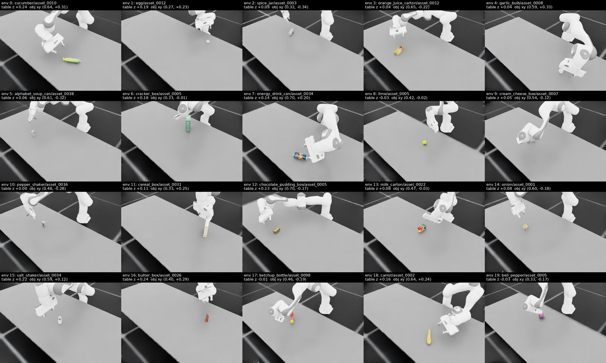

</details>

<details>
<summary><b>Pick / Upright</b></summary>

**Example assets.** 20 objects in 13 categories: beer bottle ×2, energy drink can ×2, hot sauce bottle ×2, ketchup bottle ×2, mustard bottle ×2, soda can ×2, vinegar bottle ×2, milk carton, oil bottle, orange juice carton, syrup bottle, water bottle, wine bottle.

**Reset.**
- Table height -0.06 to 0.25 m.
- Object at x 0.20 to 0.65 m, y -0.35 to 0.35 m, in one of its precomputed stable resting poses; objects on the upright list use only their upright poses.
- Arm starts from a joint configuration looked up for the object position and table height.

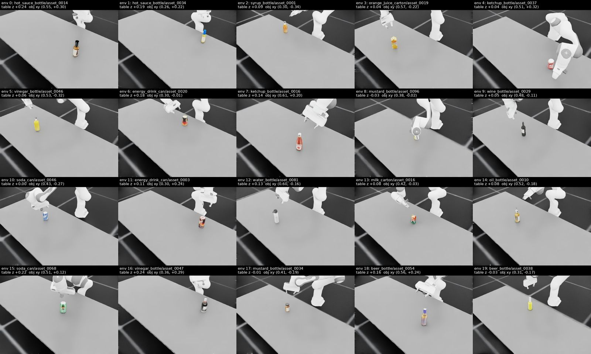

</details>

<details>
<summary><b>Pick / Concave</b></summary>

**Example assets.** 20 objects in 11 categories: black bowl 1 ×2, bowl ×2, cup ×2, drinking glass ×2, measuring cup ×2, mug ×2, ramekin ×2, red coffee mug ×2, small teacup ×2, utensil holder, white mug.

**Reset.**
- Table height -0.06 to 0.34 m.
- Object at x 0.20 to 0.76 m, y -0.35 to 0.35 m, in one of its precomputed stable resting poses; objects on the upright list use only their upright poses.
- Arm starts from a joint configuration looked up for the object position and table height.

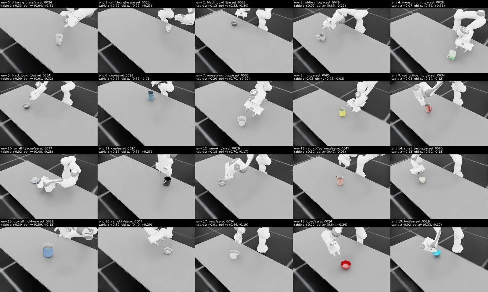

</details>

<details>
<summary><b>Pick / Concave Lying</b></summary>

**Example assets.** 20 objects in 6 categories: cup ×4, red coffee mug ×4, drinking glass ×3, mug ×3, utensil holder ×3, white mug ×3.

**Reset.**
- Table height -0.06 to 0.34 m.
- Object at x 0.20 to 0.76 m, y -0.35 to 0.35 m, in one of its precomputed stable resting poses; objects on the upright list use only their lying poses.
- Arm starts from a joint configuration looked up for the object position and table height.

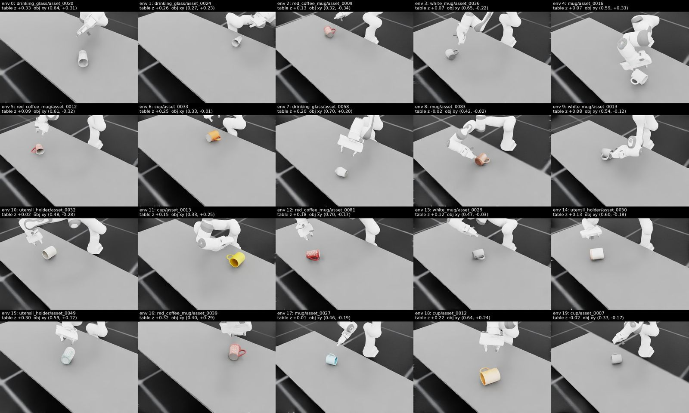

</details>

<details>
<summary><b>Pick / Handle</b></summary>

**Example assets.** 20 objects in 2 categories: left moka pot ×10, right moka pot ×10.

**Reset.**
- Table height -0.06 to 0.25 m.
- Object at x 0.20 to 0.65 m, y -0.35 to 0.35 m, in one of its precomputed stable resting poses; objects on the upright list use only their upright poses.
- Arm starts from a joint configuration looked up for the object position and table height.

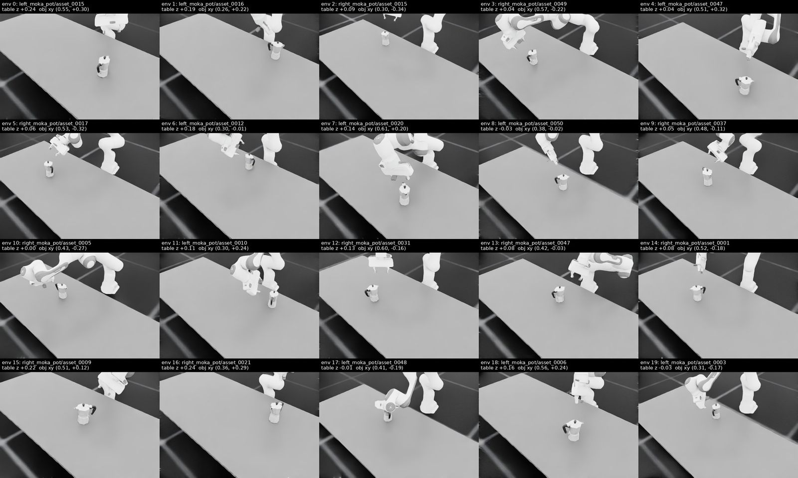

</details>

<details>
<summary><b>Place / General</b></summary>

**Example assets.** 20 objects in 20 categories: apple, avocado, banana, beer bottle, bottle opener, bowl, butter knife, carrot, cheese grater, chocolate pudding box, cracker box, cream cheese box, cucumber, cup, egg, energy drink can, fork, garlic bulb, hot sauce bottle, jam jar.

**Reset.**
- Table height -0.06 to 0.34 m.
- Object starts in the gripper, held with one of its precomputed grasps.
- Goal (green box) at x 0.20 to 0.80 m, y -0.40 to 0.40 m: a stable resting pose of the same object, chosen among the 5 poses whose tilt is closest to the object's current tilt.
- Arm starts from a joint configuration looked up for the goal position and height.

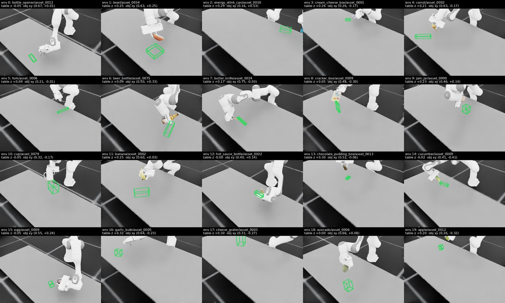

</details>

<details>
<summary><b>Place / Upright</b></summary>

**Example assets.** 20 objects in 14 categories: beer bottle ×2, energy drink can ×2, hot sauce bottle ×2, milk carton ×2, mustard bottle ×2, salad dressing bottle ×2, juice carton, ketchup bottle, oil bottle, orange juice carton, soda can, vinegar bottle, wine bottle, wine glass.

**Reset.**
- Table height -0.06 to 0.34 m.
- Object starts in the gripper, held with one of its precomputed grasps.
- Goal (green box) at x 0.20 to 0.75 m, y -0.35 to 0.35 m: an upright resting pose of the same object, chosen among the 5 poses whose tilt is closest to the object's current tilt.
- Arm starts 0.20 ± 0.05 m above the goal; the wrist is flipped when the held object is upside down.

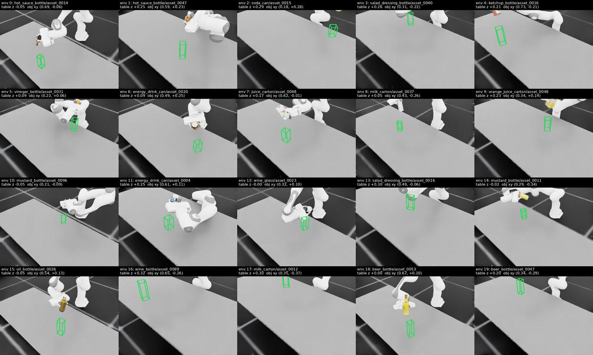

</details>

<details>
<summary><b>Open / Drawer</b></summary>

**Example assets.** 4 articulated objects (90011_joint_1, 90011_joint_2, 90021_joint_1, 90021_joint_2), 5 sizes each.

**Reset.**
- Table height -0.06 to 0.10 m.
- Object at x 0.20 to 0.70 m, y -0.50 to 0.50 m, handle side facing the robot's centerline.
- Joint starts 0–5% open.
- Arm starts solved by IK onto a hand-crafted handle grasp; the gripper then closes on the handle.

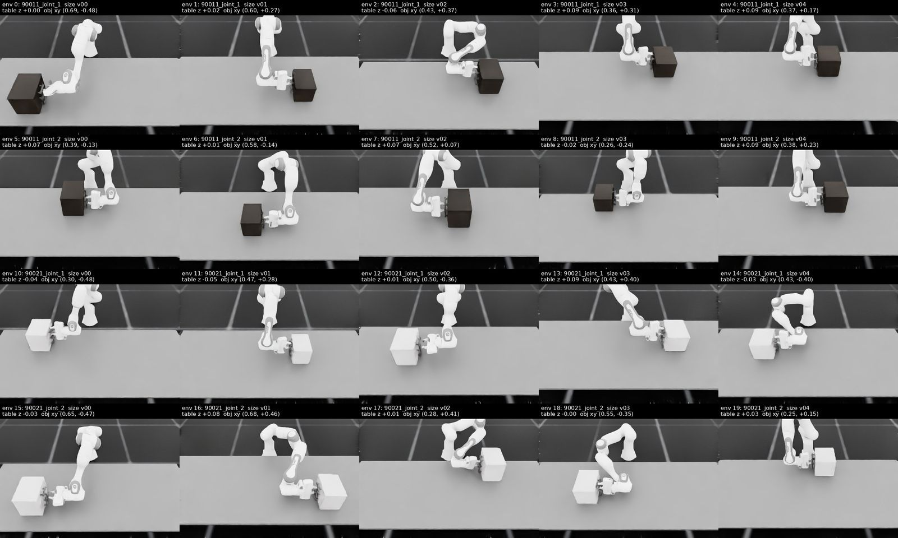

</details>

<details>
<summary><b>Open / Door</b></summary>

**Example assets.** 1 articulated object (90031_joint_0), 5 sizes each.

**Reset.**
- Table height -0.06 to 0.10 m.
- Object at x 0.35 to 0.55 m, y -0.20 to 0.20 m, handle side facing the robot's centerline.
- Joint starts 0–5% open; a curriculum starts the upper bound at 90% and anneals it over the first 20,000 env steps (shown: end of curriculum).
- Arm starts solved by IK onto a hand-crafted handle grasp; the gripper then closes on the handle.

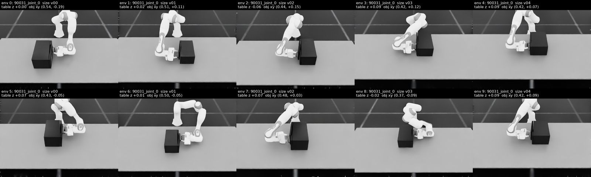

</details>

<details>
<summary><b>Close / Drawer</b></summary>

**Example assets.** 6 articulated objects (90011_joint_1, 90011_joint_2, 90011_joint_3, 90021_joint_1, 90021_joint_2, 90021_joint_3), 5 sizes each.

**Reset.**
- Table height -0.06 to 0.10 m.
- Object at x 0.20 to 0.70 m, y -0.50 to 0.50 m, handle side facing the robot's centerline.
- Joint starts 90–100% open.
- Arm starts solved by IK onto a hand-crafted push pose near the front face.

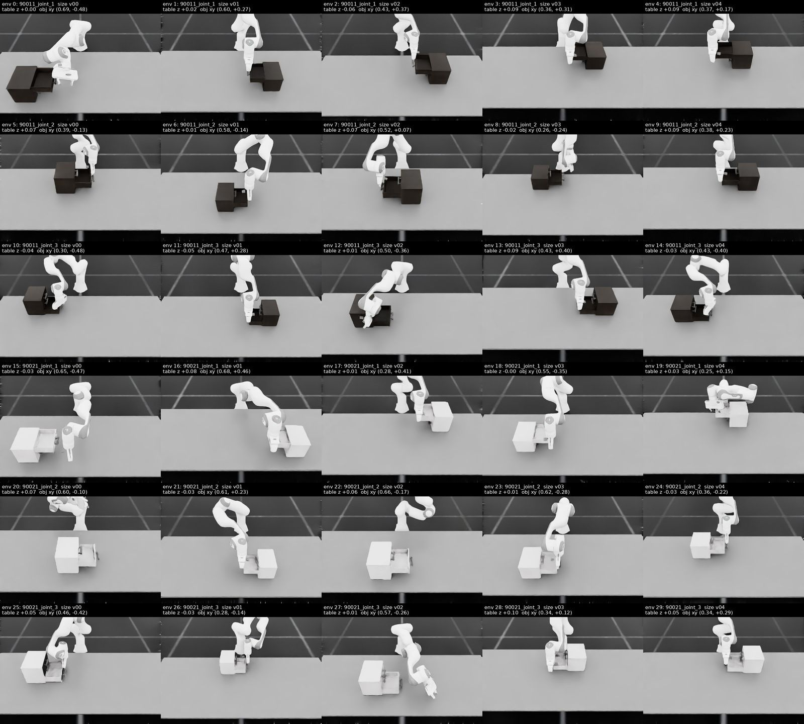

</details>

<details>
<summary><b>Close / Door</b></summary>

**Example assets.** 1 articulated object (90031_joint_0), 5 sizes each.

**Reset.**
- Table height -0.06 to 0.10 m.
- Object at x 0.20 to 0.70 m, y -0.50 to 0.50 m, handle side facing the robot's centerline.
- Joint starts 90–100% open.
- Arm starts solved by IK onto a hand-crafted push pose near the front face.

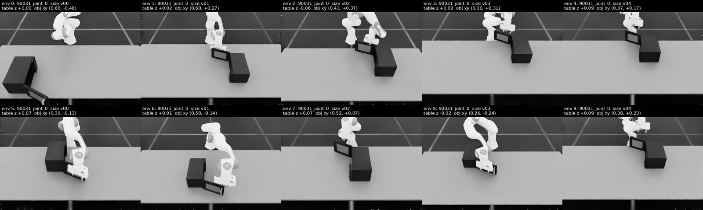

</details>

<details>
<summary><b>WidowX / Pick</b></summary>

**Example assets.** 20 objects in 20 categories: carrot, cookie box, cucumber, egg, hot sauce bottle, ketchup bottle, kitchen timer, lime, mayonnaise jar, mustard bottle, oil bottle, pasta box, pepper shaker, potato, soda can, tomato, tongs, tuna can, vinegar bottle, wine bottle.

**Reset.**
- Table height 0.00 to 0.15 m.
- Object at x 0.19 to 0.45 m, y -0.22 to 0.22 m, in one of its precomputed stable resting poses; objects on the upright list use only their lying poses.
- Arm starts from a joint configuration looked up for the object position and table height.

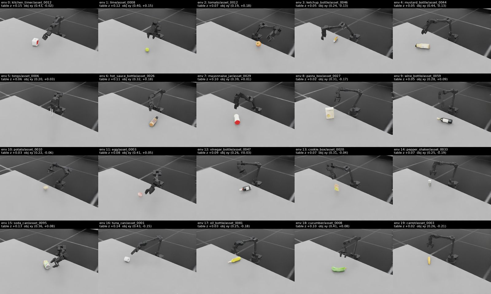

</details>

## Usage

Run the scripts with the Python interpreter of your Isaac Lab environment, from the repository root. All
commands run headless.

**Evaluate the released checkpoints**

```bash
# Pick / General
python scripts/rl_games/evaluate.py --headless --task SkillWeaver-Franka-Pick-General-v0 \
    --checkpoint data/checkpoints/pick_general.pth

# Pick / Upright
python scripts/rl_games/evaluate.py --headless --task SkillWeaver-Franka-Pick-Upright-v0 \
    --checkpoint data/checkpoints/pick_upright.pth

# Pick / Concave
python scripts/rl_games/evaluate.py --headless --task SkillWeaver-Franka-Pick-Concave-v0 \
    --checkpoint data/checkpoints/pick_concave.pth

# Pick / Concave Lying
python scripts/rl_games/evaluate.py --headless --task SkillWeaver-Franka-Pick-ConcaveLying-v0 \
    --checkpoint data/checkpoints/pick_concave_lying.pth

# Pick / Handle
python scripts/rl_games/evaluate.py --headless --task SkillWeaver-Franka-Pick-Handle-v0 \
    --checkpoint data/checkpoints/pick_handle.pth

# Place / General
python scripts/rl_games/evaluate.py --headless --task SkillWeaver-Franka-Place-General-v0 \
    --checkpoint data/checkpoints/place_general.pth

# Place / Upright
python scripts/rl_games/evaluate.py --headless --task SkillWeaver-Franka-Place-Upright-v0 \
    --checkpoint data/checkpoints/place_upright.pth

# Open / Drawer
python scripts/rl_games/evaluate.py --headless --task SkillWeaver-Franka-Open-Drawer-v0 \
    --checkpoint data/checkpoints/open_drawer.pth

# Open / Door
python scripts/rl_games/evaluate.py --headless --task SkillWeaver-Franka-Open-Door-v0 \
    --checkpoint data/checkpoints/open_door.pth

# Close / Drawer
python scripts/rl_games/evaluate.py --headless --task SkillWeaver-Franka-Close-Drawer-v0 \
    --checkpoint data/checkpoints/close_drawer.pth

# Close / Door
python scripts/rl_games/evaluate.py --headless --task SkillWeaver-Franka-Close-Door-v0 \
    --checkpoint data/checkpoints/close_door.pth

# WidowX Pick
python scripts/rl_games/evaluate.py --headless --task SkillWeaver-WidowX-Pick-v0 \
    --checkpoint data/checkpoints/widowx_pick.pth
```

Each command runs 400 environments for one episode each with deterministic actions, then prints the
success, failure and timeout rates overall and per asset; `--output results.json` saves them. Place
tightens its success tolerance and Open-Door narrows its start distribution as training progresses, so
the evaluation runs at the step count the checkpoint was trained to; `--step_counter N` evaluates at
another point.

**Record a rollout of the released checkpoints**

```bash
# Pick / General
python scripts/rl_games/play.py --headless --task SkillWeaver-Franka-Pick-General-v0 \
    --checkpoint data/checkpoints/pick_general.pth --num_envs 16 --video

# Pick / Upright
python scripts/rl_games/play.py --headless --task SkillWeaver-Franka-Pick-Upright-v0 \
    --checkpoint data/checkpoints/pick_upright.pth --num_envs 16 --video

# Pick / Concave
python scripts/rl_games/play.py --headless --task SkillWeaver-Franka-Pick-Concave-v0 \
    --checkpoint data/checkpoints/pick_concave.pth --num_envs 16 --video

# Pick / Concave Lying
python scripts/rl_games/play.py --headless --task SkillWeaver-Franka-Pick-ConcaveLying-v0 \
    --checkpoint data/checkpoints/pick_concave_lying.pth --num_envs 16 --video

# Pick / Handle
python scripts/rl_games/play.py --headless --task SkillWeaver-Franka-Pick-Handle-v0 \
    --checkpoint data/checkpoints/pick_handle.pth --num_envs 16 --video

# Place / General
python scripts/rl_games/play.py --headless --task SkillWeaver-Franka-Place-General-v0 \
    --checkpoint data/checkpoints/place_general.pth --num_envs 16 --video

# Place / Upright
python scripts/rl_games/play.py --headless --task SkillWeaver-Franka-Place-Upright-v0 \
    --checkpoint data/checkpoints/place_upright.pth --num_envs 16 --video

# Open / Drawer
python scripts/rl_games/play.py --headless --task SkillWeaver-Franka-Open-Drawer-v0 \
    --checkpoint data/checkpoints/open_drawer.pth --num_envs 16 --video

# Open / Door
python scripts/rl_games/play.py --headless --task SkillWeaver-Franka-Open-Door-v0 \
    --checkpoint data/checkpoints/open_door.pth --num_envs 16 --video

# Close / Drawer
python scripts/rl_games/play.py --headless --task SkillWeaver-Franka-Close-Drawer-v0 \
    --checkpoint data/checkpoints/close_drawer.pth --num_envs 16 --video

# Close / Door
python scripts/rl_games/play.py --headless --task SkillWeaver-Franka-Close-Door-v0 \
    --checkpoint data/checkpoints/close_door.pth --num_envs 16 --video

# WidowX Pick
python scripts/rl_games/play.py --headless --task SkillWeaver-WidowX-Pick-v0 \
    --checkpoint data/checkpoints/widowx_pick.pth --num_envs 16 --video
```

Each command records the first 200 steps of environment 0 to
`logs/rl_games/gripper/play/<time>_<task>/videos/` and exits. Episode statistics and reward terms are
printed every 100 environment steps (`env.print_interval=N` to change, `0` to silence).

**Train the sub-policies**

Each command uses the GPU count and environments per GPU of the run that produced the released
checkpoint, trained on 48 GB GPUs. Training runs for up to 20,000 epochs; the comment gives the epoch the
released checkpoint was taken at.

```bash
# Pick / General: 8 GPUs x 512 environments (released checkpoint: epoch 9600)
torchrun --standalone --nnodes=1 --nproc_per_node=8 scripts/rl_games/train.py --distributed --headless \
    --task SkillWeaver-Franka-Pick-General-v0 --num_envs 512

# Pick / Upright: 4 GPUs x 512 environments (released checkpoint: epoch 8400)
torchrun --standalone --nnodes=1 --nproc_per_node=4 scripts/rl_games/train.py --distributed --headless \
    --task SkillWeaver-Franka-Pick-Upright-v0 --num_envs 512

# Pick / Concave: 8 GPUs x 256 environments (released checkpoint: epoch 3600)
torchrun --standalone --nnodes=1 --nproc_per_node=8 scripts/rl_games/train.py --distributed --headless \
    --task SkillWeaver-Franka-Pick-Concave-v0 --num_envs 256

# Pick / Concave Lying: 8 GPUs x 256 environments (released checkpoint: epoch 2800)
torchrun --standalone --nnodes=1 --nproc_per_node=8 scripts/rl_games/train.py --distributed --headless \
    --task SkillWeaver-Franka-Pick-ConcaveLying-v0 --num_envs 256

# Pick / Handle: 4 GPUs x 256 environments (released checkpoint: epoch 4200)
torchrun --standalone --nnodes=1 --nproc_per_node=4 scripts/rl_games/train.py --distributed --headless \
    --task SkillWeaver-Franka-Pick-Handle-v0 --num_envs 256

# Place / General: 8 GPUs x 512 environments (released checkpoint: epoch 4200)
torchrun --standalone --nnodes=1 --nproc_per_node=8 scripts/rl_games/train.py --distributed --headless \
    --task SkillWeaver-Franka-Place-General-v0 --num_envs 512

# Place / Upright: 8 GPUs x 512 environments (released checkpoint: epoch 11200)
torchrun --standalone --nnodes=1 --nproc_per_node=8 scripts/rl_games/train.py --distributed --headless \
    --task SkillWeaver-Franka-Place-Upright-v0 --num_envs 512

# Open / Drawer: 1 GPU x 512 environments (released checkpoint: epoch 2200)
python scripts/rl_games/train.py --headless --task SkillWeaver-Franka-Open-Drawer-v0 --num_envs 512

# Open / Door: 1 GPU x 512 environments (released checkpoint: epoch 3800)
python scripts/rl_games/train.py --headless --task SkillWeaver-Franka-Open-Door-v0 --num_envs 512

# Close / Drawer: 1 GPU x 512 environments (released checkpoint: epoch 3600)
python scripts/rl_games/train.py --headless --task SkillWeaver-Franka-Close-Drawer-v0 --num_envs 512

# Close / Door: 1 GPU x 512 environments (released checkpoint: epoch 8400)
python scripts/rl_games/train.py --headless --task SkillWeaver-Franka-Close-Door-v0 --num_envs 512

# WidowX Pick: 8 GPUs x 512 environments (released checkpoint: epoch 9800)
torchrun --standalone --nnodes=1 --nproc_per_node=8 scripts/rl_games/train.py --distributed --headless \
    --task SkillWeaver-WidowX-Pick-v0 --num_envs 512
```

Logs and checkpoints are written to `logs/rl_games/gripper/`. Any environment setting can be overridden from
the command line with Hydra syntax, e.g. `env.table_z_range=[-0.06,0.25]`.

## Citation

```bibtex
@misc{zhu2026skillweaveragenticexplorationneural,
      title={SkillWeaver: Agentic Exploration over Neural Interaction Skills for Scalable Robot Data Generation},
      author={He Zhu and Lusen Zhao and Kwan Man Cheng and Su Li and Katerina Fragkiadaki},
      year={2026},
      eprint={2609.36171},
      archivePrefix={arXiv},
      primaryClass={cs.RO},
      url={https://arxiv.org/abs/2609.36171},
}
```

## License

Apache-2.0. `scripts/rl_games/train.py` and `play.py` are adapted from Isaac Lab (BSD-3-Clause).
